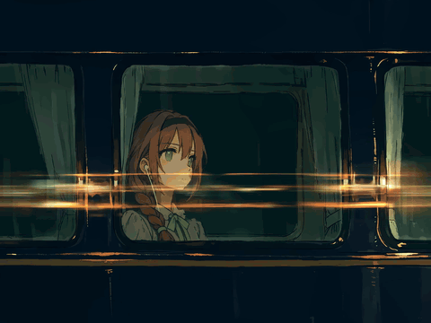
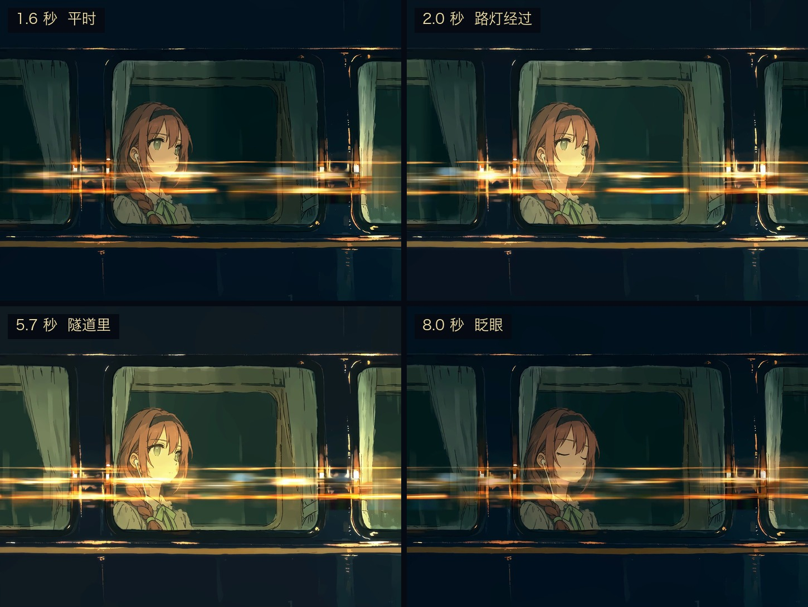
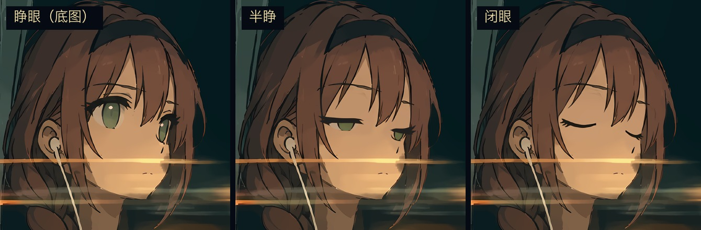
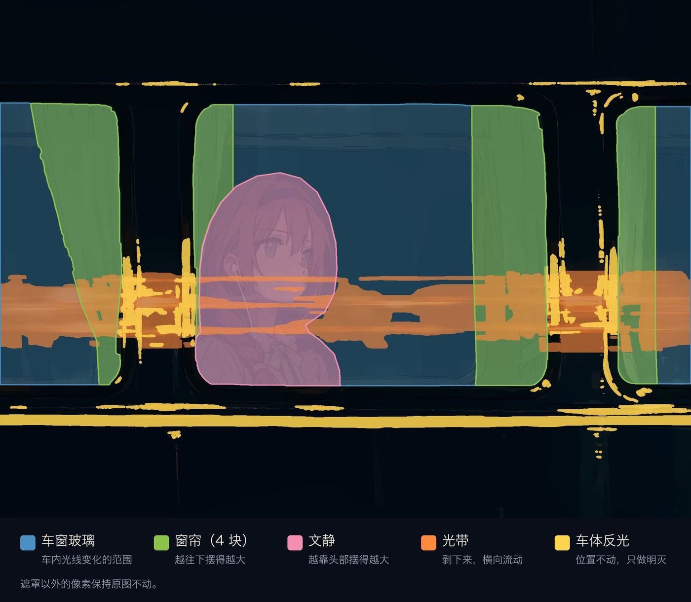
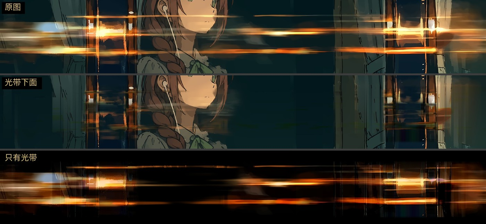

# 夜行巴士シネマグラフ · 文静版 制作分享



一张 AI 生成的静态图，加上代码逐帧算出来的动效，做成 10 秒无缝循环的局部动图（シネマグラフ）。没有用视频生成模型。

做法和构图来自シロナガス AIart 的「Claude(Fable 5.2)でシネマグラフ的演出 その11」。这里是照着原作做的一次练习：巴士、车窗、窗帘、光带都跟原作一样，只把窗里的人换成文静，再把原作的每一种动效量出来重做一遍。

- 原作成品：https://x.com/shironagasu_ai/status/2120470168841126012
- 原作者的制作过程讲解：https://x.com/shironagasu_ai/status/2120688281411281389

| | |
|---|---|
| 规格 | 10 秒无缝循环，30 fps，300 帧；4:3，母版 2048×1536 |
| 静态图 | OpenAI gpt-image 系列模型（图片编辑），一次出 3 张挑 1 张 |
| 动效 | Claude Code（Fable 5.2）写 Python 脚本并运行：NumPy + OpenCV 逐帧合成，ffmpeg 编码 |
| 人做的事 | 定方向、挑图、看样片提修改 |
| 渲染 | 300 帧约 3 分钟 |

## 成片

| 文件 | 内容 |
|---|---|
| [night-bus-wenjing_silent_30s_1440.mp4](final/night-bus-wenjing_silent_30s_1440.mp4) | 30 秒（循环 3 遍），1440×1080，无声 |
| [night-bus-wenjing_silent_30s_2048.mp4](final/night-bus-wenjing_silent_30s_2048.mp4) | 30 秒，2048×1536（母版尺寸），无声 |
| [night-bus-wenjing_silent_10s_1440.mp4](final/night-bus-wenjing_silent_10s_1440.mp4) | 10 秒单圈，1440×1080，无声；设成循环播放时首尾是接上的 |



## 10 秒里发生的事

所有动作都从同一张时间表算出来。时间表照原片逐帧量出，再按看片意见改了两处（见流程第 8 步）。

| 动的东西 | 时刻 | 怎么动 |
|---|---|---|
| 三条琥珀色光带 | 一直 | 向左流。每条带是「原方向 + 左右翻转」两层叠加，10 秒内的圈数：上 17 和 24、中 15 和 23、下 21 和 13 |
| 路灯 4 盏 | 0.7、2.0、3.3、8.9 秒 | 窗形的光斑在车内向右滑，窗柱的影子扫过脸；三扇窗先后亮起 |
| 隧道 | 4.0–7.4 秒 | 每 0.2 秒一盏灯，整窗一起亮 |
| 路面接缝 4 次 | 1.2、4.0、6.3、8.5 秒 | 整个画面上下两连击；窗帘荡开再慢慢停下；文静的头轻轻一晃 |
| 眨眼 2 次 | 2.6、8.0 秒 | 半睁 1 帧、闭眼 4 帧、半睁 1 帧 |
| 玻璃上的哈气 | 每 3.3 秒 | 嘴前方一小块，慢慢扩散再消失 |
| 车体反光 | 跟着灯 | 位置不动，只变亮度 |

## 三张图

整片只用三张图，都在 `assets/`，尺寸 2048×1536。后两张和底图相比，只有两只眼睛那一小块不同。

| 文件 | 用途 |
|---|---|
| `still.png` | 底图。遮罩和所有动效都在这张上做 |
| `blink_half.png` | 半睁眼 |
| `blink_closed.png` | 闭眼 |



## 制作流程

### 0. 先把原作读懂

原作者发了一条 94 秒的讲解视频，分 8 步：把画拆成部件、剥下光带再让它流动、定 10 秒的剧本、脸上的影子、接缝带来的摇晃、眨眼和哈气、无缝循环、用同一份剧本合成声音。结尾的一句话大意是：只让想动的地方动，而且动得有理由。

这次先把这 8 步逐条记下来，再把成品视频拆成 300 帧存在本地。原片只有两个用途：当出图的参考，以及量数字。原片的画面没有放进这个仓库。

### 1. 出静态图

用图片编辑的方式出图：把原片的一帧当底，只换窗里的人。提示词全文在 `prompts/still.txt`，参考图的顺序见 `prompts/说明.md`。

- 图 1：原片第 50 帧（没有眨眼、光线中性），放大 2 倍。右下角是原作者的标志，出图前先涂掉，免得被画进新图里（`tools/prep_base.py`）。
- 图 2：文静的官方人设图，只用来认人：发型、发色、瞳色、衣服。
- 图 3：原片女孩的头部特写放大 5 倍（`tools/crop_closeup.py`），只用来看原图是怎么画头的。

第一批只给了图 1 和图 2，三张的巴士、车窗、窗帘、光带都对得上，但人物画得比原片精致：头发线条密、眼睛细节多、肤色偏橙。第二批加了图 3，并在提示词里加了一段「怎么画」，逐条对着图 3 写：头发用几块大色块和少量长线、虹膜平涂一种颜色加一颗高光、脸上几乎没有内部线条、轮廓用粗细不匀的断续墨线。表情（一点忧郁，但已经下了决心）和白色有线耳机也是第二批写进去的。

出图后用 [gpt-anime-denoise](https://github.com/CXP-2024/gpt-anime-denoise) 的轻柔档去掉模型留下的细碎纹理，得到 `assets/still.png`。

### 2. 把画拆成部件



`tools/build_masks.py`，输入只有底图，重跑结果不变。

- **车窗玻璃**：逐行按颜色读出窗内的左右边界（窗内偏青绿，车身偏藏青）。光带经过的那几行读不出来，用上下行插值。
- **窗帘 4 块**：左窗那块的斜边按亮度读，其余三块用多边形。
- **文静**：手圈的多边形，比轮廓大 10–25 像素，渲染时再羽化。
- **光带**：竖向很薄、横向很长的亮条，分成上、中、下三条。
- **车体反光**：剥掉光带以后，玻璃外面剩下的暖色亮点。

### 3. 剥下光带，再让它流动



光带是画在图里的，要先剥下来，底下补上，才能让它单独流动。

**量原片**（`tools/measure_ref_bands.py`）：一层图案在 10 秒里绕画面 L 圈，这一行的第 n 个空间傅里叶系数就会在时间上转 n×L 圈，对它再做一次时间上的傅里叶变换，峰值的位置就是圈数。量出来上带 19 和 27、中带 17 和 26、下带 23 和 15，都往左，和原作者讲解里的数字一致。

**剥离**分三个区域，各用各的办法：

- 窗内：光带那几行用上下干净的行做竖向插值，再和原图逐通道取较暗的值，保住比插值暗的线条。
- 文静身上：只用 61 像素高的短核，脸颊、脖子、衬衫这种大块平涂才不会被当成亮条；白色的领子和耳机线靠「光带是橙色」这个条件留下。
- 窗柱和车身：只取横向够长的亮条，窗柱上的光斑留在原位。

剥下来的光带层再沿行做一次中值加高斯平滑，并把左右两端接顺，不然窗柱和耳机线留下的缺口会变成一排竖向毛刺跟着流走。最亮的芯在底图里红色通道已经到 255，剥下来偏黄绿，要按那条光带自己的色相把红色补回去。

**流动**：圈数必须是整数，循环才接得上；同一条带的两层圈数不能有公因数，否则图案会提前重复。

### 4. 量原片的每一种动

`tools/measure_ref_motion.py`，全部在原片的 300 帧上量：

- **整个画面的抖动**：先把画面变成只剩线条的拉普拉斯图（不受明暗变化影响），再用相位相关量每帧的位移。左右是 10 秒 19 个周期的轻微晃动；上下是 31 和 47 个周期叠加，压过接缝时猛抖两下，周期 4 帧，约 6 帧衰减。
- **窗帘和人的摆动**：同样的办法量局部，再减去整个画面的位移。窗帘下摆摆得最大，上端几乎不动；头部动得比身体多。
- **灯光**：把「原色 ×(1+g) + a」分别拟合到蓝、绿、红三个通道，路灯和隧道各一组系数。路灯经过时，窗形光斑以每帧 21 像素（原片 954 像素宽下）向右滑，右缘先到脸上，脸慢慢变亮，左缘（窗柱的影子）扫过时突然变暗。
- **眨眼的帧号、哈气的位置和周期**：直接从帧里读。

### 5. 眨眼帧

原作者是用代码把眼睛涂成脸颊的颜色，再画一条眼睑线。文静的眼睛细节多，照这个办法试了两轮，原来眼线的位置还是看得出补过的色块，所以改用 gpt-image：

1. 从去掉光带的底图上裁一块 640×640 的脸部特写，放大到 1024×1024；
2. 用 `prompts/blink-half.txt`、`prompts/blink-closed.txt` 各出 3 张，各挑 1 张；
3. 模型出的肤色比底图亮，先按「头发、皮肤」两个点做线性校色；
4. 只把两只眼睛那一小块沿接缝贴回底图。

### 6. 逐帧合成

`tools/render_full.py`，所有数字都在文件开头的常量里。一帧的合成顺序：

1. 去掉光带的底图
2. 眨眼的那几帧换成半睁或闭眼的图
3. 把文静的皮肤压到原片平时的亮度
4. 窗帘和文静的横向位移（一张位移场，窗框处为零）
5. 窗内打光：路灯光斑逐窗滑过，隧道段整窗发亮
6. 玻璃哈气
7. 车身加一点暖色，反光变亮并带柔光
8. 叠上流动的光带，亮度跟着灯光变
9. 整个画面平移抖动
10. 高光柔和压顶，防止脸在灯下过曝成一片白

无缝循环靠两条规矩：一直在动的东西，10 秒里正好走整数圈；只发生一次的事件，把时间当成一个环来算（第 10 秒就是第 0 秒）。编码前会核对第 300 帧和第 0 帧逐像素相同。

### 7. 从成片反过来量

用量原片的同一套办法去量导出的 mp4（`tools/check_full_mp4.py`），和原片的数字并排比：

- 上下抖动和原片的相关系数 0.90，幅度（均方根）0.76 像素，原片 0.77；四次接缝的峰值帧 39、119、194、256，和原片是同一帧。
- 窗帘下摆的摆幅 −3.3 到 +1.7 像素，原片 −3.9 到 +2.5；头部 −0.9 到 +1.5，原片 −1.4 到 +1.7（都按原片 954 像素宽换算）。
- 暗车厢、左右窗帘、车身四处的亮度曲线，和原片的相关系数在 0.95–0.99。
- 光带的圈数从 mp4 里反测出来是 17/24、15/23、21/13，和设定一致。
- 首尾相接处的帧差 4.4，相邻帧 3.8–4.1；编码前第 300 帧和第 0 帧逐像素相同。
- 对面窗框在整个循环里的最大位移，按公式算是 0。

### 8. 看片后的修改

- **对面的窗框不能动。** 第一版里，中间车窗里对面那个窗框会跟着窗帘一起晃。原因是窗帘摆动的权重边缘是羽化的，把旁边的窗框线也带上了。改成摆动只从窗帘自己的斜边开始，窗框处的位移按公式算出来是 0。
- **光带慢一成。** 圈数从原片的 19/27、17/26、23/15 改成 17/24、15/23、21/13，仍然是整数，每条带的两层仍然互质。
- **不要连眨。** 原片在 8.0 秒和 8.4 秒连眨两次，这里只留第一下。
- 成片定为无声，另外出一条循环 3 遍的 30 秒版。

## 踩过的坑

- **整幅图做竖向开运算来找亮条，会把不到核高的皮肤也当成亮条剥走。** 要分区域，用不同高度的核。
- **按通道分别做横向开运算会留下彩虹色的残渣**，要用一个亮度比例同时作用在三个通道上。
- **位移场的羽化会带动旁边不该动的线条。** 边界要放大、叠上网格看清楚再定，凭亮度曲线猜会猜错。
- **模型改出来的脸比底图亮**（红色通道高 9–17），贴回前要先校色。

## 仓库里有什么

```
final/       三条成片
assets/      三张图：底图、半睁眼、闭眼
prompts/     三张图的提示词全文，和参考图说明
tools/       遮罩与剥离、逐帧合成、出片脚本；量原片和核对成片的脚本
docs/img/    这个 README 的插图
```

## 想自己跑

```bash
pip install -r requirements.txt
python tools/build_masks.py .
python tools/render_full.py .
sh tools/make_final.sh
```

- 另外需要 ffmpeg（带 libx264）。
- `build_masks.py` 生成 `masks/`，`render_full.py` 生成 `out/final_picture_master.mp4` 和 `out/final_picture_1440.mp4`，`make_final.sh` 生成 `final/` 里的三个文件。
- `python tools/render_full.py . --check-only` 只做编码前的核对；`--dump=79,150` 另存指定帧。
- 环境：Python 3.14、NumPy 2.5、OpenCV 5.0、Pillow 12.3、ffmpeg 8.1（macOS）。在这个环境下，从仓库里的三张图重跑一遍，得到的三个文件和 `final/` 里的逐字节相同；别的版本没有试过。
- 遮罩示意图上的中文标注用的是 macOS 自带字体；别的系统上找不到字体时会跳过示意图，遮罩照常生成。
- `prep_base.py`、`crop_closeup.py`、`frame_stats.py`、`measure_ref_bands.py`、`measure_ref_motion.py`、`check_full_mp4.py` 需要原片的逐帧图，仓库里没有，用法写在各文件开头。这些脚本里的坐标是按原片 954×720 的画面写的。`check_full_mp4.py` 还要先把成片抽帧到 `work/step4_frames/`。

更推荐的用法是照着流程，让 Claude Code 之类的 AI 编程工具按你自己的图重写一遍：遮罩的多边形、光带的行号、眼睛的位置都是这张图专用的。

## 没放进仓库的

- 原片的视频和画面，以及和原片的左右对照。
- 文静的官方人设图。
- 调用出图接口、去纹理、局部贴回用的通用小工具（不是这个项目专用的），做法写在上面的流程里。
- 声音。原作带一条用公式合成的声音，这次也照做过一版，但最后定下来的成片是无声的。

## 已知的小毛病

- 文静脖子上有一道很淡的灰色横痕不会动，是底图里光带的柔光没剥干净。
- 灯下的窗帘比原片偏绿，隧道里略暗。
- 玻璃上的哈气偏淡。

## 出处与版权

- 这是粉丝二创，不是官方作品。
- 构图、巴士场景的画法和整套动效的设计来自シロナガス AIart 的原作，底图是以原作的一帧为参考由 AI 改画的。原片的视频和画面没有放进仓库。
- 文静的形象归权利人所有（官方人设图上的标注：© 2021 OriginalForce/KADOKAWA AOHANE/Tencent）。
- 三张图由 OpenAI 的 gpt-image 模型生成，是 AI 生成的图片。
